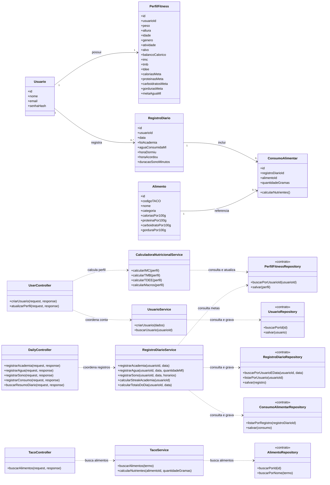

# Modelagem — Projeto 1

**Aluno(a):** Raul Henrique Alves de Sousa  
**Domínio:** Tracker de atividades fitness

## 1. O domínio

O app permite que uma pessoa acompanhe seus hábitos de saúde e atividade física. A pessoa mantém um perfil com dados corporais e objetivo, registra diariamente idas à academia, consumo de água e sono, e adiciona alimentos consumidos usando os valores nutricionais da tabela TACO.

O perfil apresenta estimativas de IMC, TMB, TDEE e metas diárias de energia e macronutrientes. O histórico diário mostra os registros e uma sequência (streak) de dias consecutivos com ida à academia. Os cálculos são estimativas informativas e não substituem orientação profissional.

O front-end será em React/Vite e consumirá uma API REST; a API será organizada em rotas, controllers, services e models. O front terá dashboard com gráficos e formulário de refeições. A tecnologia de persistência fica fora desta modelagem para manter o projeto simples.

## 2. Entidades

| Entidade | Atributos | Relacionamentos |
|---|---|---|
| Usuario | id, nome, email, senhaHash | possui um perfil fitness e vários registros diários |
| PerfilFitness | id, usuarioId, peso, altura, idade, genero, atividade, alvo, balancoCalorico, imc, tmb, tdee, caloriasMeta, proteinasMeta, carboidratosMeta, gordurasMeta, metaAguaMl | pertence a um usuário; mantém dados corporais e metas |
| Alimento | id, codigoTACO, nome, categoria, caloriasPor100g, proteinaPor100g, carboidratoPor100g, gorduraPor100g | aparece em vários consumos alimentares |
| RegistroDiario | id, usuarioId, data, foiAcademia, aguaConsumidaMl, horaDormiu, horaAcordou, duracaoSonoMinutos | pertence a um usuário; contém consumos alimentares |
| ConsumoAlimentar | id, registroDiarioId, alimentoId, quantidadeGramas | pertence a um registro diário e referencia um alimento |

`Usuario` mantém identidade/acesso e `PerfilFitness` mantém dados corporais, objetivo e resultados nutricionais. `peso` será medido em kg e `altura` em cm. Os valores metabólicos são recalculados quando os dados usados nas fórmulas ou o objetivo mudam. `senhaHash` representa somente o hash, nunca a senha em texto puro. O projeto tem gênero `M/F` e objetivos `BULKING/CUTTING`; o projeto deverá validar as opções e poderá acrescentar manutenção como objetivo. `caloriasMeta` e metas de macros são metas calculadas, enquanto os valores consumidos são obtidos dos registros e refeições do dia.

Cada usuário tem no máximo um registro diário por data. A presença na academia é representada por `foiAcademia`; o streak é derivado das datas consecutivas com esse campo verdadeiro, não armazenado como contador independente. O sono fica associado à data em que a noite termina, para que horários que cruzam a meia-noite formem um único registro.

`Alimento` contém calorias, proteínas, carboidratos e gorduras; `codigoTACO`, `categoria` e a convenção de valores por 100 g. A importação TACO povoa esses valores; `ConsumoAlimentar` registra a quantidade usada na refeição. Os totais diários são calculados somando os consumos, em vez de apagar o histórico com um reset diário de contadores.

## 3. Diagrama de classes

## 4. Responsabilidades

| Classe | Papel | Único motivo para mudar |
|---|---|---|
| Usuario | identidade e acesso | dados ou regras da conta |
| PerfilFitness | dados corporais, objetivo e metas calculadas | regras do perfil e avaliação nutricional |
| Alimento | dados nutricionais importados da TACO | formato ou atualização da tabela |
| RegistroDiario | hábitos associados a uma data | campos e validações dos registros diários |
| ConsumoAlimentar | alimento e quantidade consumida | cálculo nutricional por porção |
| CalculadoraNutricionalService | IMC, TMB, TDEE e metas de macros | fórmulas e regras nutricionais |
| RegistroDiarioService | gravação e agregação de hábitos, streak e resumo diário | regras dos trackers |
| TacoService | busca de alimentos e cálculo proporcional por porção | consulta e regras da TACO |
| UsuarioService | criação e consulta da conta | regras de cadastro e consulta de usuário |
| Controllers | traduzir HTTP em chamadas aos services e respostas | rotas e formatos da API |
| Repositories | contratos para consultar e persistir cada modelo | operações de acesso a dados necessárias |

## 5. Onde apliquei SRP e DIP

- **SRP:** `Usuario` cuida da identidade e `PerfilFitness` dos dados corporais e metas. `CalculadoraNutricionalService` concentra fórmulas relacionadas; `RegistroDiarioService` gerencia os hábitos e resumos diários; `TacoService` pesquisa a tabela e calcula nutrientes por porção. Controllers tratam HTTP e repositories definem operações de persistência. As entidades não têm métodos de salvar dados, enviar e-mail ou lidar com HTTP.
- **DIP:** os services dependem dos contratos `UsuarioRepository`, `PerfilFitnessRepository`, `RegistroDiarioRepository`, `ConsumoAlimentarRepository` e `AlimentoRepository`, não de uma tecnologia concreta de persistência. A implementação do armazenamento fica para uma etapa futura; os controllers chamam services, não executam as regras de negócio.

## 6. Fora do escopo (YAGNI)

Neste primeiro projeto ficam fora: integração com relógios ou balanças, leitura de códigos de barras, planos de treino, rede social, notificações, recomendações clínicas e sincronização com serviços externos. Os cálculos apresentados são estimativas; o app não diagnostica nem prescreve tratamento.